# итоговая работа audit-svc

делал по варианту 2 (github actions) потому что gitlab с harbor не тянет мой ноут

- образ публикуется в ghcr.io/meepok17/audit-svc
- деплой делает self-hosted runner `wsl-deploy` с меткой `deploy` прямо в моем wsl (ubuntu 24.04) это и есть целевая машина
- репозиторий публичный потому что на бесплатном аккаунте environments и rulesets для приватных репо не работают. workflow запускается только по push (main и теги v*) поэтому из форков код на моей машине не запустится. в settings → actions стоит approval для всех внешних контрибьюторов

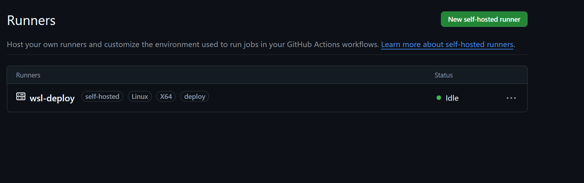

## что где лежит

- `Dockerfile` `.dockerignore` - образ
- `.github/workflows/ci.yml` - пайплайн test → build → deploy
- `deploy/` - ansible плейбук, шаблоны конфига сервиса и nginx, vault
- `monitoring/` - prometheus и grafana, дашборды в `monitoring/grafana/`

## 1 сборка и публикация образа

**dockerfile** многоступенчатый как nonroot из дз3. в build стадии poetry export + pip wheel + poetry build, в финальную копируется только dist и ставится через pip. пользователь `audit` uid 1001 создается addgroup/adduser как в семинаре

```
$ docker run --rm audit-svc:local id
uid=1001(audit) gid=1001(audit) groups=1001(audit),100(users)
$ docker run --rm audit-svc:local sh -c 'which server migrate generate'
/usr/local/bin/server
/usr/local/bin/migrate
/usr/local/bin/generate
```

uid 1001 выбрал специально такой же как у моего пользователя devops в wsl. конфиг на хосте лежит с правами 0640 и владельцем devops поэтому процесс в контейнере его читает

**пайплайн на main**: test (`poetry run pytest --junitxml=report.xml`, отчет грузится артефактом junit-report) → build (публикация `main_<короткий sha>`) → deploy пропускается

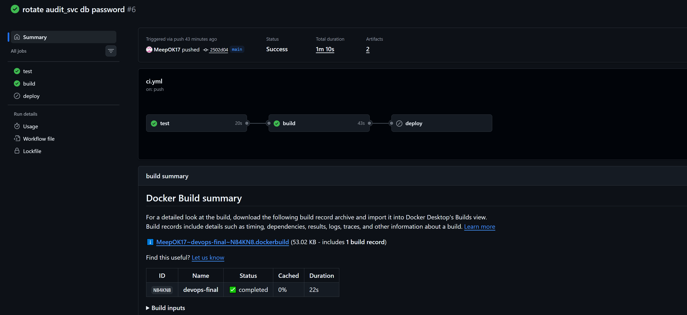

логин в реестр через встроенный `GITHUB_TOKEN` с `packages: write`, паролей в файле нет. кусок лога публикации

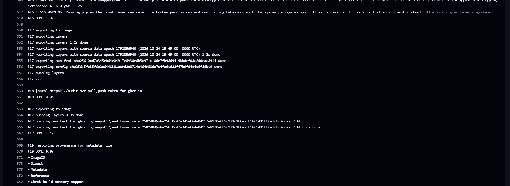

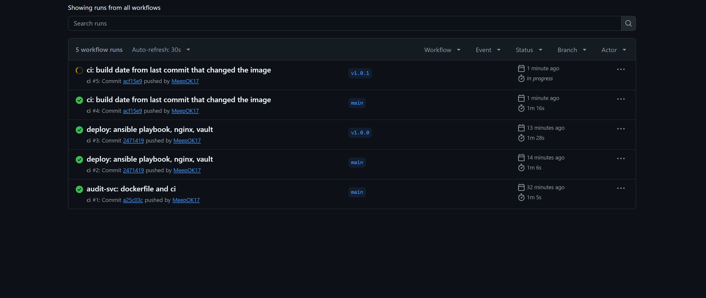

**пайплайн на теге v*** тот же но образ с тегом `vX.Y.Z` и потом deploy

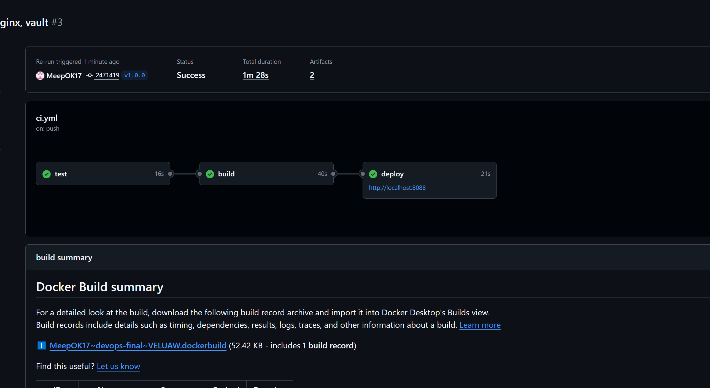

### воспроизводимая сборка

без нее не прошла бы проверка смены пароля (новый тег = новый образ = контейнер пересоздается). сделал так
- в сборку передается `SOURCE_DATE_EPOCH` и включен `rewrite-timestamp=true` у buildkit. время в метаданных и у файлов в слоях берется оттуда
- python при заданном SOURCE_DATE_EPOCH компилирует .pyc с хешем вместо времени (checked-hash) а useradd берет из нее дату в /etc/shadow
- `SOURCE_DATE_EPOCH` это время последнего коммита который менял файлы образа (`git log -1 --format=%ct -- Dockerfile .dockerignore pyproject.toml poetry.lock README.md src`), для этого checkout с `fetch-depth: 0`. если брать время просто последнего коммита то коммит с новым паролем менял бы образ
- provenance выключен

проверка - main и тег из одного коммита дали один и тот же digest

```
Name:      ghcr.io/meepok17/audit-svc:main_2471419
Digest:    sha256:48f7cb4d98d724c8128724a8cb07f4982030349ff7ba72c7042ddce4c4b62589

Name:      ghcr.io/meepok17/audit-svc:v1.0.0
Digest:    sha256:48f7cb4d98d724c8128724a8cb07f4982030349ff7ba72c7042ddce4c4b62589
```

в packages видно что гитхаб сам склеил теги с одинаковым образом. v1.0.2 main_2502d04 v1.0.1 main_acf15e9 main_a25c03c это один образ потому что код образа в этих коммитах не менялся

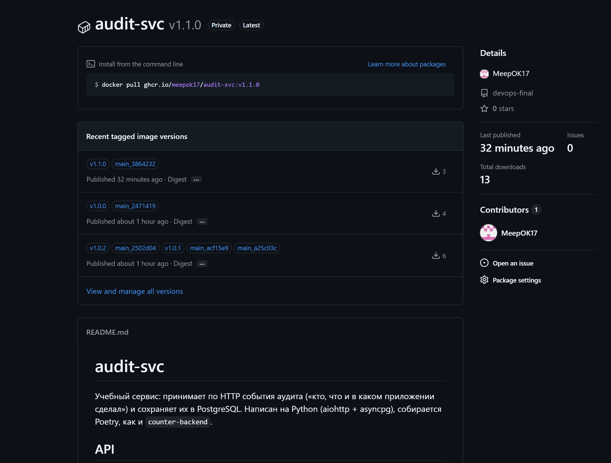

## 2 база данных и секреты

- postgres:17 в контейнере `audit-postgres`, данные в томе `audit-pgdata`. порт только на `127.0.0.1:15432` чтобы ansible с хоста мог создать бд и пользователя (5432 у меня занят постгресом из дз2)
- бд `audit` и пользователь `audit_svc` (владелец бд) создаются задачами `community.postgresql.postgresql_user` и `postgresql_db`
- пароли суперпользователя и audit_svc в `deploy/inventories/prom/group_vars/all/vault.yml` зашифрованы ansible-vault. в задачах с паролями стоит `no_log: true`
- ключ от vault лежит в секрете окружения `production` на гитхабе. у окружения правило что оно доступно только тегам `v*` (аналог protected). ansible берет ключ через `vault_password_file = vault-pass.sh`, скрипт просто печатает переменную окружения `ANSIBLE_VAULT_PASSWORD`

```
$ head -3 deploy/inventories/prom/group_vars/all/vault.yml
$ANSIBLE_VAULT;1.1;AES256
30613136306237333938623462663463613835363237343537623062646436326232623761663437
6565323564353330376365343561323662303533306561320a313936643037643366656262343038
```

## 3 развертывание из ci

плейбук `deploy/audit-svc.play.yml`, все контейнеры через `community.docker`. задача deploy в workflow запускается только на тегах (`if: startsWith(github.ref, 'refs/tags/v')`), после build, на раннере с меткой deploy, в окружении production с url `http://localhost:8088`. разворачивает образ с тегом релиза (`-e image_tag=...`)

конфиг сервиса генерится шаблоном `config.yaml.j2` из переменных vault, права 0640. монтирую в контейнер папку `/data/audit-svc/conf` а не сам файл - template пишет новый файл и подменяет старый, и если смонтировать файл то контейнер продолжит видеть старый

при изменении конфига хендлер дергает `POST /reload` через `docker exec` в контейнере сервиса (снаружи reload закрыт). контейнер не перезапускается

первый деплой из ci

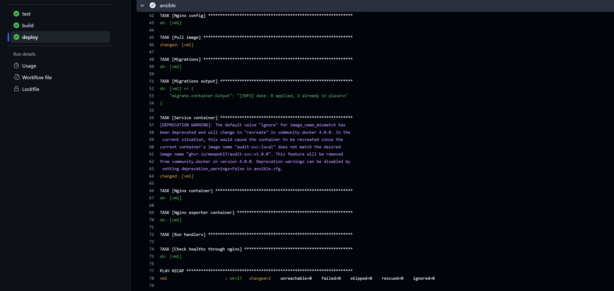

повторный запуск без изменений - `changed=0`, хендлеры не срабатывают

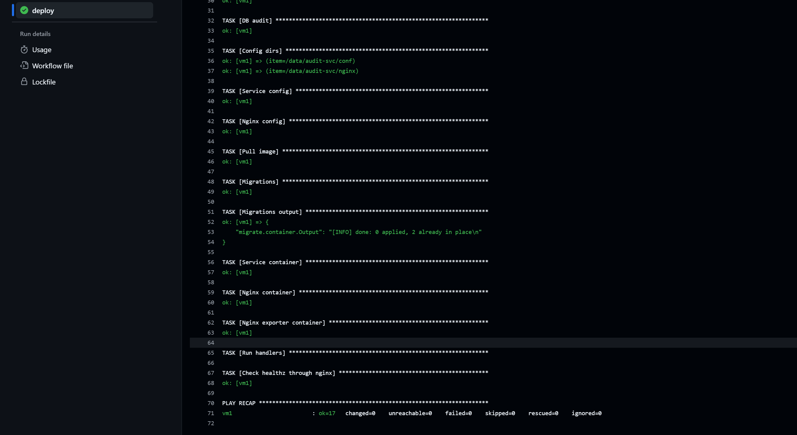

### смена пароля

до

```
$ docker ps --format '{{.Names}}\t{{.Image}}'
audit-svc       ghcr.io/meepok17/audit-svc:v1.0.1
$ docker inspect -f '{{.State.StartedAt}}' audit-svc
2026-10-24T16:24:58.895693505Z
$ curl -s localhost:8088/metrics | grep 'audit_config_reloads_total{'
(пусто, перезагрузок еще не было)
```

поменял пароль `vault_audit_db_password` через `ansible-vault edit`, закоммитил, тег v1.0.2. в логе деплоя `DB user audit_svc` changed, `Service config` changed, `Service container` ok, хендлер `Reload audit-svc` выполнен

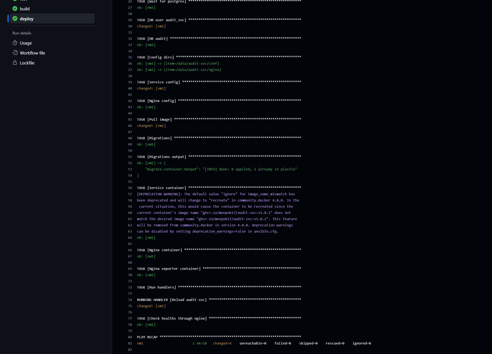

после

```
$ docker ps --format '{{.Names}}\t{{.Image}}'
audit-svc       ghcr.io/meepok17/audit-svc:v1.0.1
$ docker inspect -f '{{.State.StartedAt}}' audit-svc
2026-10-24T16:24:58.895693505Z
$ docker logs audit-svc 2>&1 | grep 'config reloaded'
2026-10-24 16:30:53,645 [INFO] audit_svc.main: config reloaded, reconnected to the database
$ curl -s localhost:8088/metrics | grep 'audit_config_reloads_total{'
audit_config_reloads_total{result="success"} 1.0
$ curl -s -o /dev/null -w '%{http_code}\n' localhost:8088/healthz
200
```

startedat тот же. имя в docker ps осталось v1.0.1 потому что контейнер не пересоздавался, а образ v1.0.2 тот же самый

```
$ docker image inspect -f '{{.Id}}' ghcr.io/meepok17/audit-svc:v1.0.1 ghcr.io/meepok17/audit-svc:v1.0.2
sha256:0cd7a345eb64e04917e8930e6b5c971c106e7fb9869419bb0efd8c2ddeac8914
sha256:0cd7a345eb64e04917e8930e6b5c971c106e7fb9869419bb0efd8c2ddeac8914
$ docker inspect -f '{{.Image}}' audit-svc
sha256:0cd7a345eb64e04917e8930e6b5c971c106e7fb9869419bb0efd8c2ddeac8914
```

## 4 nginx и nginx-exporter

- сервис и postgres в сети `audit` без портов наружу. порт публикуют только nginx (8088) и exporter (9113)
- в nginx `location ^~ /reload { return 404; }`. nginx матчит location по нормализованному uri (раскодирует %xx и склеивает //) поэтому обходы тоже ловятся
- `proxy_pass` через переменную и `resolver 127.0.0.11` (dns докера) чтобы имя сервиса резолвилось при каждом запросе а не один раз при старте, иначе после пересоздания контейнера был бы 502
- stub_status на отдельном порту 8081 который не публикуется, exporter ходит туда по сети audit

```
$ curl -s localhost:8088/healthz
{"status": "ok"}
$ docker logs audit-svc 2>&1 | grep -c 'config reload'
0
$ curl -s -o /dev/null -w '%{http_code}\n' -X POST localhost:8088/reload
404
$ curl -s -o /dev/null -w '%{http_code}\n' -X POST 'localhost:8088/reload?x=1'
404
$ curl -s -o /dev/null -w '%{http_code}\n' -X POST localhost:8088//reload
404
$ curl -s -o /dev/null -w '%{http_code}\n' -X POST localhost:8088/%72eload
404
$ docker logs audit-svc 2>&1 | grep -c 'config reload'
0
$ curl -s -o /dev/null -w '%{http_code}\n' localhost:8088/stub_status
404
$ curl -s localhost:9113/metrics | grep ^nginx_up
nginx_up 1
$ docker ps --format '{{.Names}}\t{{.Ports}}'
audit-nginx-exporter    0.0.0.0:9113->9113/tcp
audit-nginx     80/tcp, 0.0.0.0:8088->8080/tcp
audit-svc       8080/tcp
audit-postgres  127.0.0.1:15432->5432/tcp
```

## 5 мониторинг

`monitoring/compose.yaml` - prometheus и grafana из дз3 без node exporter. prometheus подключен к сети `audit` как внешней. метрики сервиса собираются через nginx (`audit-nginx:8080/metrics`), exporter `audit-nginx-exporter:9113`

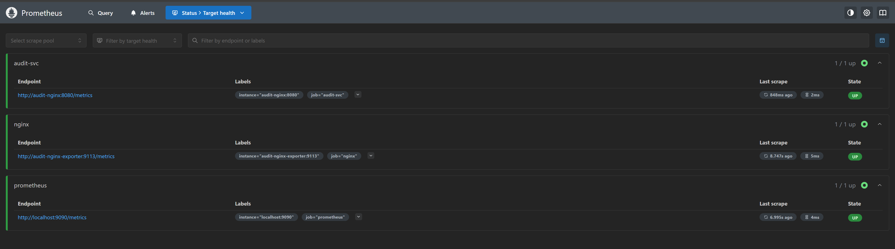

нагрузка

```
$ docker run -d --rm --name audit-generate --network audit ghcr.io/meepok17/audit-svc:v1.1.0 generate --url http://audit-nginx:8080 --duration 900
$ curl -s localhost:8088/metrics | grep '^audit_events_received_total'
audit_events_received_total{app="billing"} 321.0
audit_events_received_total{app="auth"} 172.0
audit_events_received_total{app="orders"} 126.0
audit_events_received_total{app="profile"} 57.0
```

свой дашборд `monitoring/grafana/audit-svc.json`

- события в секунду `sum by (app) (rate(audit_events_received_total[1m]))`
- коды ответов % `100 * sum by (code) (rate(audit_http_requests_total[1m])) / scalar(sum(rate(audit_http_requests_total[1m])))`, линии стекаются в 100
- сервис запущен stat по `up{job="audit-svc"}` с маппингом 1 → UP зеленый 0 → DOWN красный

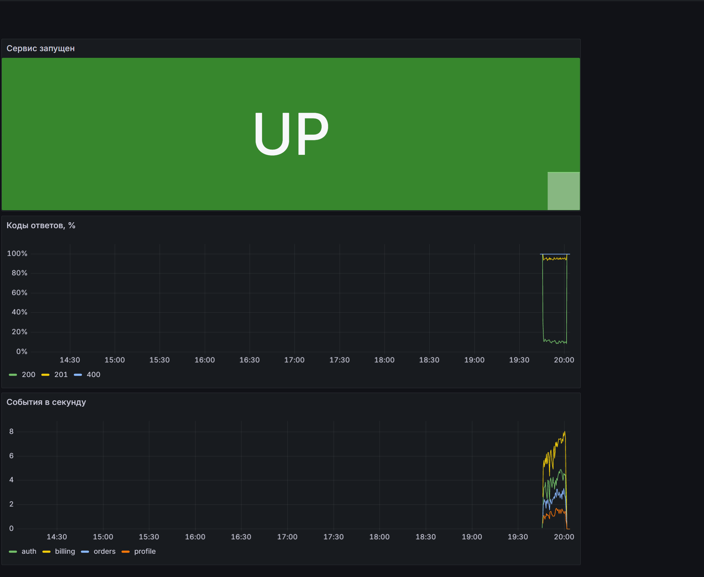

остановил сервис `docker stop audit-svc` - nginx отдает 502 на /metrics, up стал 0

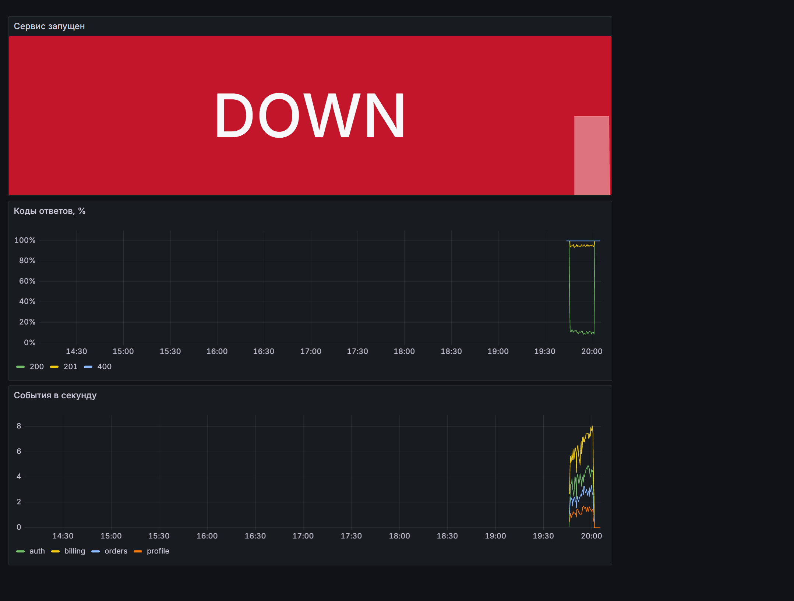

`docker start audit-svc` - снова up

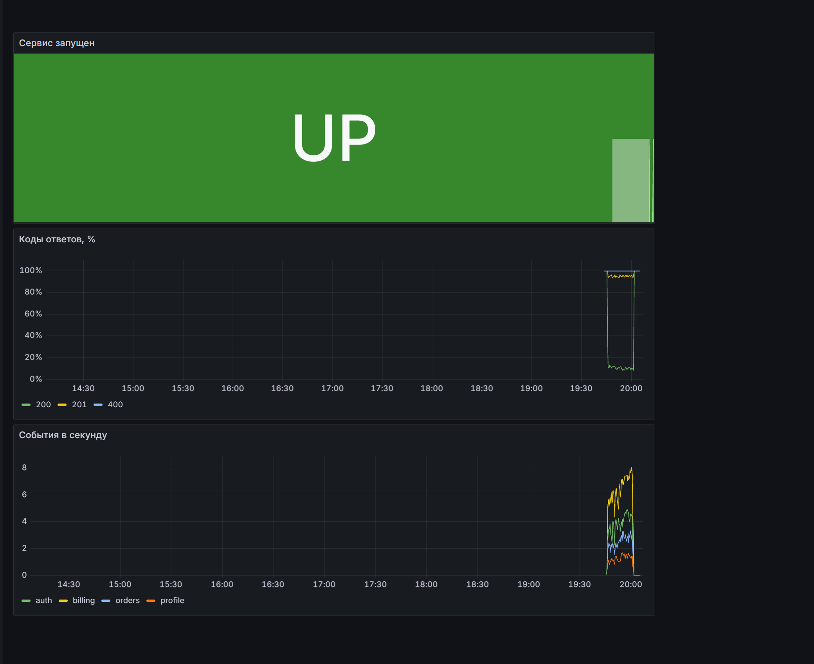

дашборд nginx из репозитория nginx-prometheus-exporter импортирован, json в `monitoring/grafana/nginx.json`

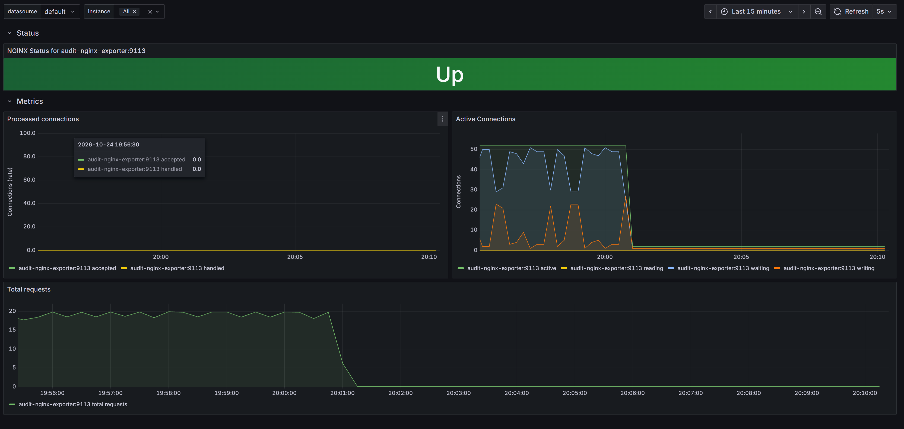

## ★ миграции при каждом деплое

в плейбуке перед контейнером сервиса запускается `migrate` в одноразовом контейнере из нового образа (`docker_container` с `detach: false`). если миграции упадут контейнер завершится с ошибкой и задача упадет, до обновления сервиса дело не дойдет. changed только если что то применилось (`changed_when: "' 0 applied' not in ..."`), поэтому повторный запуск не ломает идемпотентность

добавил `src/audit_svc/migrations/0003_events_actor_index.sql` (индекс по actor), тег v1.1.0

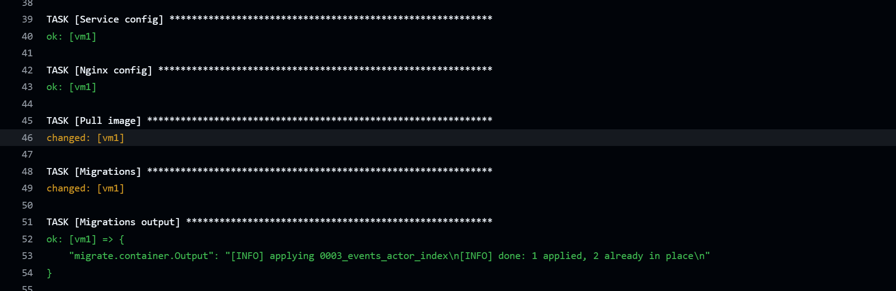

```
$ docker exec audit-postgres psql -U postgres -d audit -c '\di events*'
 Schema |             Name             | Type  |   Owner   | Table
--------+------------------------------+-------+-----------+--------
 public | events_actor_received_at_idx | index | audit_svc | events
 public | events_app_received_at_idx   | index | audit_svc | events
 public | events_pkey                  | index | audit_svc | events
```

при деплоях без новых миграций в логе `done: 0 applied, 2 already in place` (это видно на скрине повторного запуска выше)
